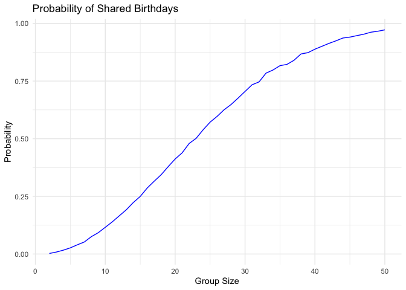
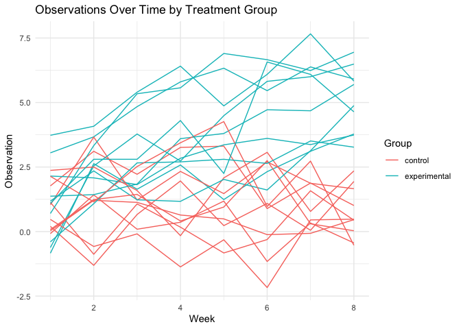
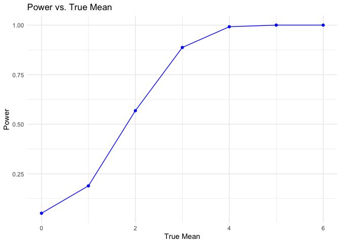
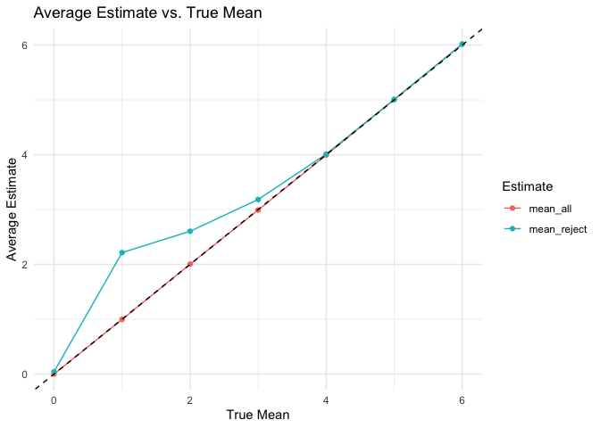

P8105 Homework 5
================
Jinghao Zhang

``` r
library(tidyverse)
```

## Problem 1

``` r
set.seed(1)

birthday = function(n) {
  days = sample(1:365, n, replace = TRUE)
  any(duplicated(days))
}
```

``` r
results =
  expand_grid(
    n = 2:50,
    iter = 1:10000
  ) |>
  mutate(
    same = map_lgl(n, birthday)
  ) |>
  group_by(n) |>
  summarize(
    prob = mean(same)
  )
```

``` r
results |>
  ggplot(aes(x = n, y = prob)) +
  geom_line(color = "blue") +
  labs(
    title = "Probability of Shared Birthdays",
    x = "Group Size",
    y = "Probability"
  ) +
  theme_minimal()
```

<!-- -->

The probability that at least two people share a same birthday increase
as the group size becomes larger. The probability is approximately 1
when the group size reaches 50.

## Problem 2

``` r
files = tibble(
  file = list.files("data", pattern = "\\.csv$", full.names = TRUE)
)
```

``` r
files = files |>
  mutate(
    data = map(file, read_csv, show_col_types = FALSE)
  )
```

``` r
study_data = files |>
  unnest(data) |>
  mutate(
    arm = if_else(str_detect(file, "con_"), "control", "experimental"),
    id = str_extract(file, "\\d+")
  ) |>
  pivot_longer(
    week_1:week_8,
    names_to = "week",
    values_to = "value"
  ) |>
  mutate(
    week = as.numeric(str_remove(week, "week_"))
  ) |>
  select(id, arm, week, value)

study_data
```

    ## # A tibble: 160 × 4
    ##    id    arm      week value
    ##    <chr> <chr>   <dbl> <dbl>
    ##  1 01    control     1  0.2 
    ##  2 01    control     2 -1.31
    ##  3 01    control     3  0.66
    ##  4 01    control     4  1.96
    ##  5 01    control     5  0.23
    ##  6 01    control     6  1.09
    ##  7 01    control     7  0.05
    ##  8 01    control     8  1.94
    ##  9 02    control     1  1.13
    ## 10 02    control     2 -0.88
    ## # ℹ 150 more rows

``` r
study_data |>
  ggplot(aes(x = week, y = value,
             group = interaction(arm, id),
             color = arm)) +
  geom_line() +
  labs(
    title = "Observations Over Time by Treatment Group",
    x = "Week",
    y = "Observation",
    color = "Group"
  ) +
  theme_minimal()
```

<!-- -->

The observations from experimental group generally increased over time.
The observations from control group generally remained stable. After
week 7, all the observations in experimental group were higher than
those in the control group.

## Problem 3

``` r
set.seed(1)

sim_test = function(mu) {
  x = rnorm(30, mean = mu, sd = 5)
  t.test(x, mu = 0) |>
    broom::tidy() |>
    select(estimate, p.value)
}
```

``` r
results3 =
  expand_grid(
    mu = 0:6,
    iter = 1:5000
  ) |>
  mutate(
    test = map(mu, sim_test)
  ) |>
  unnest(test)
```

``` r
power_data = results3 |>
  group_by(mu) |>
  summarize(
    power = mean(p.value < 0.05)
  )

power_data
```

    ## # A tibble: 7 × 2
    ##      mu  power
    ##   <int>  <dbl>
    ## 1     0 0.0508
    ## 2     1 0.189 
    ## 3     2 0.568 
    ## 4     3 0.887 
    ## 5     4 0.992 
    ## 6     5 1     
    ## 7     6 1

``` r
power_data |>
  ggplot(aes(x = mu, y = power)) +
  geom_line(color = "blue") +
  geom_point(color = "blue") +
  labs(
    title = "Power vs. True Mean",
    x = "True Mean",
    y = "Power"
  ) +
  theme_minimal()
```

<!-- -->

The power increases as the true mean increases. This implies that larger
effect sizes are easier to detect.

``` r
mean_data = results3 |>
  group_by(mu) |>
  summarize(
    mean_all = mean(estimate),
    mean_reject = mean(estimate[p.value < 0.05])
  )

mean_data
```

    ## # A tibble: 7 × 3
    ##      mu  mean_all mean_reject
    ##   <int>     <dbl>       <dbl>
    ## 1     0 -0.000262      0.0426
    ## 2     1  0.996         2.21  
    ## 3     2  2.00          2.60  
    ## 4     3  2.99          3.18  
    ## 5     4  3.99          4.01  
    ## 6     5  5.01          5.01  
    ## 7     6  6.02          6.02

``` r
mean_data |>
  pivot_longer(
    mean_all:mean_reject,
    names_to = "type",
    values_to = "mean"
  ) |>
  ggplot(aes(x = mu, y = mean, color = type)) +
  geom_line() +
  geom_point() +
  geom_abline(slope = 1, intercept = 0, linetype = "dashed") +
  labs(
    title = "Average Estimate vs. True Mean",
    x = "True Mean",
    y = "Average Estimate",
    color = "Estimate"
  ) +
  theme_minimal()
```

<!-- -->

The average estimate of mean of all samples generally equal to the true
mean. However, the average estimate of mean only in samples for which
the null was rejected is higher than the true mean at small values of
true mean. This is because larger estimates are more likely to have
significant results.
